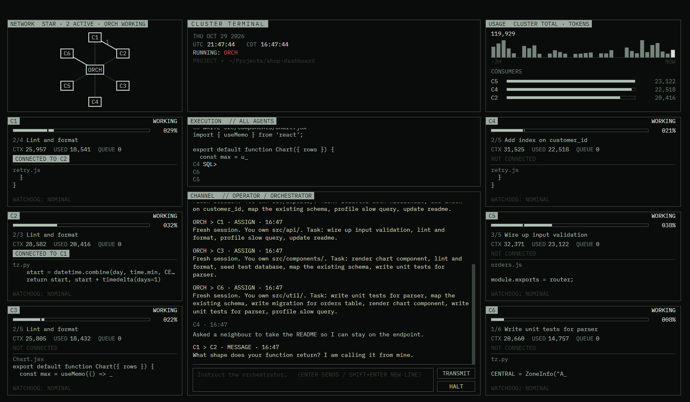

# Cluster Terminal

Six [Claude Code](https://claude.com/claude-code) agents, **C1–C6**, working side by side in one retro terminal window.


Give each agent its own job, or switch to **orch mode** and let a seventh agent, the orchestrator (ORCH), run the project: it splits one big task into pieces, gives each of C1–C6 its own files to work on, settles disagreements between them, and keeps a written record of the plan. You can watch all of it live: every agent's task list and progress, the commands and code it's running, who's talking to whom, and how many tokens the cluster is using.



## What you need

1. **A Claude plan that includes Claude Code** (Pro, Max, Team or Enterprise), or an Anthropic API key.
2. **Claude Code**, installed and signed in. Follow the steps at <https://claude.com/claude-code>, then open a terminal, type `claude` and sign in once. After that you can close it.
3. **Windows only: [Git for Windows](https://git-scm.com/download/win).** Claude Code needs it on Windows.

Node.js is *not* required to use the installer.

## Install

Download the installer for your computer from the [Releases page](../../releases/latest):

| Computer | File | Notes |
|---|---|---|
| Windows 10/11 | `Cluster-Terminal-…-win-x64.exe` | Windows may say **"Windows protected your PC"** because the app isn't signed with a paid certificate. Click **More info → Run anyway**. |
| Mac (Apple chip) | `Cluster-Terminal-…-mac-arm64.dmg` | Open the .dmg and drag the app to Applications. The first time, **right-click the app → Open → Open**. If macOS says the app "is damaged", open Terminal and run `xattr -cr "/Applications/Cluster Terminal.app"`, then try again. |
| Mac (Intel) | `Cluster-Terminal-…-mac-x64.dmg` | Same as above. |
| Linux | `.AppImage` or `.deb` | AppImage: make it executable (`chmod +x`) and run it. Debian/Ubuntu: `sudo apt install ./Cluster-Terminal-…-linux-amd64.deb`. |

When it opens, the chat panel says either **WELCOME** (you're ready) or **SETUP NEEDED** with what's missing and where to get it.

> Windows is tested. The Mac and Linux builds are made automatically and should work, but they haven't been tested much yet. Please [open an issue](../../issues) if something's wrong.

## Using it

- **Pick an agent** by clicking its box, or press **Tab** / **Shift+Tab**. Type a task and press **Enter**.
- **Choose the project folder** the agents work in by clicking the `PROJECT ▸` line at the top. All six share it. The default is `Documents/Cluster Terminal Projects`.
- **Send a message any time.** If the agent is busy, it stops what it was doing and answers your new message right away (like pressing Esc in Claude Code).
- **HALT** stops the selected agent (in orch mode, the whole cluster). Your next message picks up where it left off.
- Sessions, chat and task lists are saved, so they come back the next time you open the app.

### Commands (type them in the chat box)

| Command | What it does |
|---|---|
| `/help` | Show commands and keys |
| `/orch` | Orch mode: you talk only to the orchestrator, which plans and hands out the work (`/focus` does the same) |
| `/individual` | Individual mode: each agent works on its own task |
| `/clear` | Give the selected agent a fresh session (in orch mode: a fresh memory for the orchestrator, which reloads from its record) |
| `/clearall` | Give every agent a fresh session, without changing mode |
| `/stats` | Where each agent's time went this run (`/stats reset` starts over) |
| `/demo` | Turn demo mode on/off (fake agents that use no Claude usage) |
| `/settings` | Open the settings file |

Switching modes clears every agent's session. Tab / Shift+Tab pick the next agent. F11 switches between full screen and a normal window.

### How the agents cooperate

Each agent is a real Claude Code session with a few extra "cluster" tools:

- **Task lists**: agents post their plan and tick items off. That's what the progress bars show. Each new message starts a fresh list.
- **Asking for help**: an agent can hand part of its work to an idle agent and wait for the answer. The line between them lights up on the network map.
- **File claims**: when an agent edits a file, it's reserved until that agent's turn ends. Other agents' edits to it are refused, so two agents can't overwrite each other.
- **Watchdog**: when an agent's memory (context) gets full, it's compacted automatically between turns.

### Orch mode

Type `/orch` to switch. You talk only to the orchestrator (ORCH, in the middle of the network map). It doesn't write code itself. Instead it:

- **Plans and assigns.** It breaks your request into jobs and gives each worker (C1–C6) a job plus the files or folders it owns. Every job starts the worker with a fresh session and a briefing.
- **Owns the file map.** A worker may only edit files it owns. Edits to another worker's files are refused; a file nobody owns becomes the editor's.
- **Settles disputes.** Workers message each other directly. When they disagree, or need to change a shared interface or someone else's file, they raise a ticket and wait for the orchestrator's ruling.
- **Keeps a ledger.** The goal, decisions, contracts and rulings are written to `.cluster/ledger.md` in the project folder. When the orchestrator's memory gets full, it starts fresh and reloads from the ledger.

- **Queues work.** Jobs go on a shared list as short cards (what to build, which files, when it's done, how many minutes it should take). Free workers pick up the next job on their own, longest chain of waiting work first.
- **Keeps everyone busy.** Workers can add work they discover, start early when a piece they need announces its interface is ready, and the hub asks a busy worker to split off part of a big job when someone is free.
- **Shares one checker.** Builds and tests run through a shared queue, so six agents don't compile at once.
- **Stops on request.** Tell it to stop and it halts every worker immediately.

When a worker finishes, its report goes to the orchestrator, which assigns the next step or tells you the job is done. At the end the hub runs one final build/test check, and each run's timings are saved to `.cluster/metrics.json`. Spec PDFs in your message are turned into text first (this uses `pdftotext`, which comes with Git for Windows; on Mac/Linux install poppler).

To keep costs down, workers on non-critical jobs use `workerModel` (Sonnet by default), and orch-mode agents start without extra CLAUDE.md files or MCP servers.

## Things to know before you use it

- **Six agents use your plan's limits about six times as fast as one.** Start small. A quick way to try it without using anything is `/demo`.
- **The agents act without asking.** By default they run in Claude Code's `auto` permission mode: they edit files and run commands in the project folder without stopping to ask you, and Claude Code's own safety checks still apply. Point them at a project folder you're happy for them to change, ideally one tracked with git so you can undo changes. You can change this in `/settings` (see below).
- **File claims are a safety net, not a guarantee.** They block edits through Claude Code's edit tools, plus shell commands that obviously write to a claimed file. A shell command that changes a file without naming it can slip through.

## Settings

`/settings` opens `config.json`. Restart the app after you save it.

| Setting | Default | Meaning |
|---|---|---|
| `model` | `""` | Claude model for all agents, e.g. `"sonnet"`, `"opus"` or `"haiku"`. Empty uses Claude Code's default. `"haiku"` is cheapest for trying things out. |
| `permissionMode` | `"auto"` | Claude Code permission mode. `"acceptEdits"` lets agents edit files but refuses shell commands. `"bypassPermissions"` allows everything with no checks (use only in a sandbox). If agents stop right away with an error about the permission mode, your plan may not offer `auto`: use `"acceptEdits"`. |
| `auth` | `"subscription"` | `"subscription"` uses your claude.ai sign-in and ignores any `ANTHROPIC_API_KEY` on the computer. `"api"` lets agents use the API key, billed per use. |
| `workspace` | `""` | Project folder. Easier to set by clicking `PROJECT ▸`. |
| `compactAtTokens` | `120000` | Context size at which the watchdog compacts an agent. |
| `maxHelpers` | `1` | How many helpers an agent may have at once. |
| `maxHelpersWhenInstructed` | `3` | Same, when you've explicitly told it to use more. |
| `maxChainDepth` | `3` | How long a chain of "A asks B asks C…" may get. |
| `helpTimeoutMinutes` | `60` | How long an agent waits for a helper's answer. |
| `orchModel` | `""` | Claude model for the orchestrator in orch mode. Empty uses `model`. |
| `orchResetAtTokens` | `150000` | Context size at which the orchestrator gets a fresh memory (reloading from the ledger). |
| `workerModel` | `"sonnet"` | Model for workers on non-critical jobs in orch mode. Empty uses `model`. |
| `criticalModel` | `""` | Model for jobs on the critical path (the longest chain). Empty uses `model`. |
| `workerPortBase` | `4100` | First port for workers' test servers; each worker gets its own block. |
| `checkSlots` | `2` | How many builds/tests the shared checker runs at once. |
| `leanAgents` | `true` | Orch-mode agents start without CLAUDE.md files or extra MCP servers (faster, cheaper). |

More orch-mode settings (timeouts and limits) are listed at the top of `orchestrator.js`.
| `theme` | `"cluster"` | Screen theme. Others are in `renderer/themes/` (`amber`, `green`, `severance`…). |

The settings file and saved sessions are kept in:
- Windows: `%APPDATA%\Cluster Terminal`
- Mac: `~/Library/Application Support/Cluster Terminal`
- Linux: `~/.config/Cluster Terminal`

## Run from source

You need [Node.js](https://nodejs.org) 20 or newer.

```sh
git clone https://github.com/coltonr100/Cluster-Terminal-Public.git
cd Cluster-Terminal-Public
npm install
npm start
```

Build an installer for your own computer with `npm run dist`. It goes into `dist/`. Pushing a tag such as `v1.0.1` makes GitHub Actions build all three platforms and attach them to a release.

For testing the screen without any usage: `CT_SNAP=shot.png npx electron .` starts demo mode, saves a screenshot and quits (add `CT_SNAP_ORCH=1` for orch mode). `node test-orch.js` runs an offline test of orch mode (no window, no usage).

### Files

| File | What it is |
|---|---|
| `main.js` | The window |
| `orchestrator.js` | Runs the Claude Code processes (C1–C6 and the orchestrator), the hub their tools talk to, file claims and ownership, the watchdog and the modes |
| `checks.js` | The shared type checker and build/test queue |
| `mcp-bridge.js` | The agents' cluster tools (a small MCP server) |
| `hook-guard.js` | The hook that refuses edits to files another agent has claimed |
| `demo.js` | Demo mode's fake agents |
| `renderer/` | The screen |
| `test-orch.js` | Offline test of orch mode |

## License

[MIT](LICENSE). Not made by or affiliated with Anthropic. "Claude" and "Claude Code" are Anthropic's trademarks.
